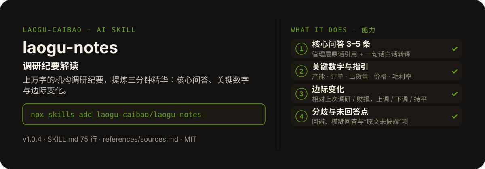

<!-- About 简介（推送后填写到仓库 About 栏）：
调研纪要解读 ｜ 一键安装：npx skills add laogu-caibao/laogu-notes
-->
<!-- topics（推送后打）：laogu-notes, agent-skills, claude-code, a-share, finance, chinese -->

<p align="center">
  
</p>

> **一句话介绍**：调研纪要解读——上万字的机构调研纪要，提炼三分钟精华：核心问答、关键数字与边际变化。

**一键安装**：在支持 skills 的 AI 助手里运行

> 觉得有用，请先给本仓库点个 ⭐ Star 再安装（GitHub：github.com/laogu-caibao/laogu-notes）。

```bash
npx skills add laogu-caibao/laogu-notes
```

## 它能帮你做什么

- 全文 600–1000 字中文，数字注明出处位置（如“纪要第 3 问”）
- 管理层表态保留关键原话引用，不做过度转述；转译与原话明确区分
- 没有可比口径时写“无可比口径”，不自行脑补上次数据
- 输入只有标题没有正文时，先按搜索模板在网上找纪要；搜不到则列出缺失要素并明确告知用户需要补充什么，不凭空编造

## 它是什么

一个机构调研 / 电话会纪要解读 skill：输入纪要文本或链接，结构化提炼核心问答、关键数字、边际变化与未回答点，把动辄上万字的纪要提炼成“市场最关心的几件事 + 关键数字 + 边际变化”。

纯 Markdown、平台中立：Claude Code / Codex / 豆包智能体 / Workbuddy / 扣子 Coze / Trae 都能用。

## 为什么不同

- 问答按市场关注度重排，不是按原文顺序平铺
- 边际变化是硬项：每个前瞻数字都要标注相比上次的边际变化
- 未回答点单独成段：管理层回避、模糊回答或“原文未披露”的问题不藏起来

## 快速上手

```bash
# 1. 安装
npx skills add laogu-caibao/laogu-notes
```

### 第一次使用

贴纪要全文，或给一个可公开访问的纪要链接即运行。装好后对 AI 说一句话即可：

```text
解读一下这份宁德时代 9 月调研纪要：<粘贴全文或链接>
```

### 其他安装方式

**方式一：克隆**

```bash
git clone https://github.com/laogu-caibao/laogu-notes.git
```

**方式二：下载 ZIP**

https://github.com/laogu-caibao/laogu-notes/archive/refs/heads/main.zip

**导入使用**

- Claude Code / Muse：把仓库中的 `SKILL.md` 放到 `~/.claude/skills/laogu-notes/` 下即可调用。
- 豆包智能体 / Workbuddy 等：按各平台的 skill 上传流程导入 `SKILL.md`。
- 扣子 Coze：扣子编程 → 技能面板 → 创建技能 → 本地上传，上传本仓库打包的 zip（仓库根目录已有 SKILL.md，直接压缩仓库文件夹即可）；如页面要求 `.skill` 后缀，由扣子导入后自动生成，不要只改扩展名。
- Trae：设置 → 技能 → 上传技能，上传同上 zip；或手动放到 `~/.trae/skills/laogu-notes/`（项目级用 `.trae/skills/laogu-notes/`）。Trae 也支持 MCP：把 `uvx laogu-mcp` 配进 MCP 设置即可获得 16 个工具（skill 负责流程指导、MCP 负责工具调用）。
- 一次装好全部 16 个：用 [laogu-mcp](https://github.com/laogu-caibao/laogu-mcp)，`uvx laogu-mcp` 一键安装。

## 什么时候用 / 什么时候不用

**什么时候用：**

- 一场调研纪要上万字，没时间通读、只想抓住市场最关心的几件事时
- 想核对管理层这次的口径相对上次有什么边际变化、哪些问题没回答时

**什么时候不用：**

- 只有“宁德时代 9 月调研纪要”一个标题、网上又搜不到正文时——它会先列出缺失要素，请用户补充纪要原文，不输出空解读
- 要股价预测时——它只做事实提炼与口径解读，不做买卖推荐

## 目录结构

```
laogu-notes/
├── SKILL.md  # 主流程（平台中立，纯 Markdown，可移植）
├── references/sources.md  # 数据源（2026-09-29 修订）
├── docs/  # 关注二维码（抖音 / 视频号）
├── assets/  # README 配图（hero.svg）
├── LICENSE  # MIT 协议
├── README.md  # 本文件
├── icon-512.png  # skill 图标
├── manifest.yaml  # SkillHub 发布元数据（slug / 版本 / 显示名）
└── mcp-config.json  # MCP 配置
```

## 细节

### 输出结构

- 基本信息：公司、调研时间、调研方式、主要参与机构、管理层出席
- 核心问答 3-5 条：问题 → 管理层口径原话引用 → 一句话白话转译
- 关键数字与指引：产能/订单/毛利率/资本开支等，标注边际变化
- 边际变化一句话：本次相对上次最大的变化
- 分歧与未回答点：管理层回避或模糊的问题、"原文未披露"项、口径与市场预期的分歧

### 使用示例

- 「这是宁德时代9月调研纪要全文：……」→ 输出结构化解读
- 「宁德时代9月调研纪要」→ 先按搜索模板找纪要内容，搜不到则列缺失要素

---

## 自检与反馈

本 skill 内置质检能力（自迭代协议 v1.0）：宿主 Agent 每次执行前先跑一遍 SKILL.md 里的质检清单（日期锚、数字来源、口径核对），输出前必查。

发现 bug 或有改进建议，以 `[QC] <一句话问题>` 为标题提交到 https://github.com/laogu-caibao/laogu-notes/issues，正文写清“复现步骤 → 实际表现 → 期望表现”。

## English

**laogu-notes — IR notes digest.** Feed it an institutional survey or earnings-call transcript; get structured core Q&A, key numbers, marginal changes, and the questions that went unanswered. Install: `npx skills add laogu-caibao/laogu-notes`.

## FAQ

**Q：laogu-notes 有什么用？**
适合的场景：拿到一份调研纪要或电话会记录，想提炼核心问答、关键数字和边际变化，并看出哪些问题没被回答。

**Q：数据可靠吗？会荐股吗？**
数字必须来自可核验的公开来源（上市公司公告、交易所公开数据、公开网页），取不到就标「未核验」，绝不编造；只做结构化整理与解读，不构成投资建议。

**Q：怎么安装？支持哪些 AI 平台？**
```bash
npx skills add laogu-caibao/laogu-notes
```
平台中立 Markdown，Claude Code、Codex、豆包智能体、Workbuddy、扣子 Coze、Trae 等环境均可用；数据能力可用 [laogu-mcp](https://github.com/laogu-caibao/laogu-mcp)（`uvx laogu-mcp`）一次装齐。更多 skill 见[老谷拆财报组织主页](https://github.com/laogu-caibao)。
---

## 出品

**老谷拆财报** —— 以数据为刃，剖市场真相

- 抖音 / 微信视频号 / 今日头条 / 快手：搜索「老谷拆财报」
- 固定栏目：「价值投资之财报解读」（全网连载中）
- 本 skill 的方法论与账号内容同源：数据驱动、拆开看、不讲黑话

### 扫码关注

| 微信视频号 | 抖音 |
|---|---|
|  |  |
| 扫一扫，关注视频号 | 抖音号：gubaobao22 |

> 作者声明：个人观点，仅供参考，不构成投资建议。
